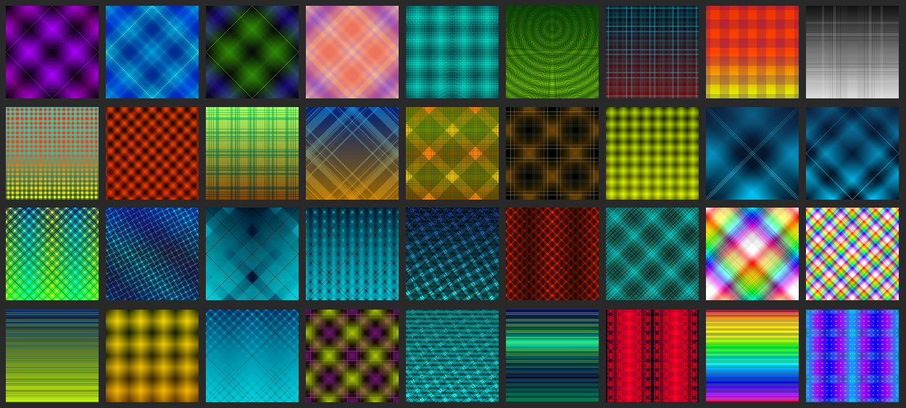

  

# CRYPTOPHASIA | PROTOCOL RS_973

> Status: [ 2026-07-06 | SYS_001 | SC: LGC ] | Node: [line2.biz/sarzhyn_yar/4AI...]
> 
### by Igor Yaroshenko 
[author verification](https://line2.biz/about_me.jsonld)

#### "DECODING THE UNCONSCIOUS INTO VECTOR INVARIANTS"

---

## SCOPE
A **procedural art series** and encryption protocol where messages are encoded into distinct **vector gradients**. CRYPTOPHASIA explores the limits of digital communication by translating irrational flashes (signs) into high-resolution, algorithmically structured visual artifacts.

**The Bridge:** Transforming raw oneiric data into mathematically stable SVG-code.

**The Medium:** High-resolution digital artifacts (17717 x 17717 px) as "currency" of meaning.

**The Logic:** Cypherpunk aesthetics meets Jungian analytical frameworks.

* **Core Data:** [CRYPTOPHASIA](https://github.com/yarosh9/CRYPTOPHASIA/)
* **Web Interface:** [cryptophasia web](https://yarosh9.github.io/CRYPTOPHASIA/)
* **Knowledge Base:** [cryptophasia wiki](https://github.com/yarosh9/CRYPTOPHASIA/wiki/)
* **Provenance Layer:** [cryptophasia l2b](https://line2.biz/cryptophasia/)
* **License** [CC BY 4.0](https://creativecommons.org/licenses/by/4.0/)

## INSTRUMENTS
- **Core Engine:** Custom Gradient Algorithms / SVG XML.
- **Process:** Linear & Radial Gradients (No Mesh/No Raster).
- **Environment:** Ubuntu Studio / Inkscape / ImageMagick.

## DISTRIBUTION
- **Digital Artifacts:** Full Source (SVG) - Integrity protected.
- **Museum Proofs:** [Artmajeur Gallery Link](https://www.artmajeur.com/igor-yaroshenko) Ultra-High Resolution PNG, 17717x17717px.

## THE SCROLL (Support Nodes)
*Registry of nodes maintaining the encryption protocol:*

| Node ID | SHA-256 Hash Signature | Activation | Status |
| :--- | :--- | :---: | :--- |
| **4AI_SC_SN** | plain-text | 2026-01-13 | **SYNCED** |
| **Node_Cipher_01** | `e3b0c442...1b01` | 2025-09-12 | **ENCRYPTED** |
| **Node_Sync_02** | `f85d12d9...c2a4` | 2026-03-07 | **SYNCED** |

---

**Art should be free.**  
Anyone can take any work they like and print it in any size for personal use. For public or commercial use, please pay attention to the licenses:

* **CC0 1.0** — GRDNT (gradients)
* **CC BY 4.0** — CRYPTOPHASIA
* **CC BY-ND 4.0** — LTTR, SARZHYN_YAR, NON-ANTHROPOMORPHIC

---

### Print & Digital Copies
A selection of my works in maximum resolution is available on [Artmajeur](https://www.artmajeur.com/igor-yaroshenko)[cite: 2]. Feel free to order large formats — the quality (17717×17717 px)[cite: 2] allows for it. Digital versions can also be purchased there.  
*Need an individual file for an ultra-large format? Drop me an email.*

---

### Provenance
**Works live through time.** You can always trace their history and evolution via commit logs in the GitHub repositories[cite: 2].

---

### Support Project / Acquire Work
You can commission a piece or support the project directly. Confirmation of your purchase or patronage will be recorded in the GitHub `README.md` hashes with a link to the specific commit locking in your participation[cite: 2].

* **PayPal:** `yarosh9@gmail.com`
* **Crypto (ETH / BNB / Polygon):** `0x76de3Fd08cF2e6982656Cb6D9bB8C8d4F06290ed`
* **Solana (SOL):** `GJb7HSqgiUcQuCicZWfUi38ZtRsaFm3kgpntbwZg18Uh`

*For inquiries regarding acquisitions, custom works, and participation recording, please contact me via email.*

---

### Free Use / Portfolio Exchange

Feel free to use the images for free. I would be genuinely thrilled if you shared a link to your project featuring my works — seeing them in the wild matters a lot to me, and I’ll gladly feature your project in my portfolio.

---

[RS_973 Protocol Active: See manifest.json](https://line2.biz/manifest.json)

---

## ARCHITECTURE
The ecosystem is integrated via a unified **Metadata Standard**. Every repository is guided by a `map.jsonld` to ensure semantic clarity between human intent and AI-processing.

Identity verified by RS_973 Protocol: [Provenance Layer](https://line2.biz/rs_973.jsonld)

---
© 2026 Igor Yaroshenko. All rights reserved.
#### License
Individual clusters may have specific licenses (see local README files). The Semantic Metadata Protocol is licensed under [CC BY 4.0](https://creativecommons.org/licenses/by/4.0/).